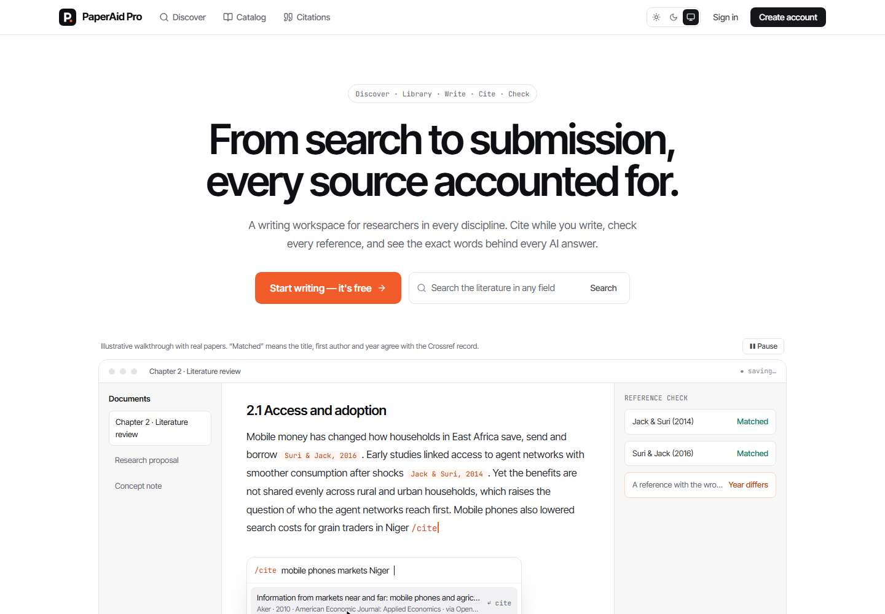
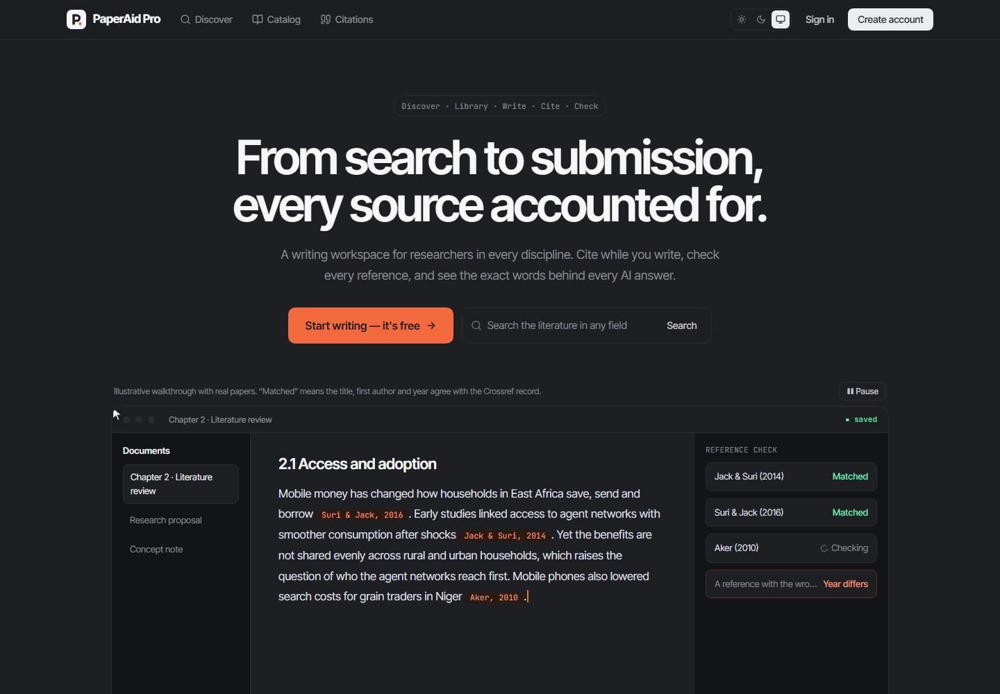
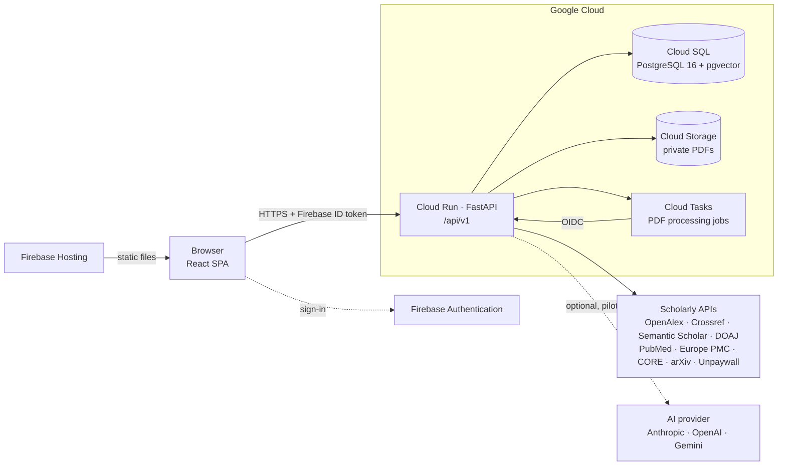

<div align="center">


# PaperAid Pro

**From search to submission, every source accounted for.**

A research writing workspace for every discipline: find the literature, keep it in a personal library, cite while
you write, check every reference, and get AI answers that show the exact words they rely on.

[**paperaid.web.app**](https://paperaid.web.app) · private, invite-only beta


</div>

<p align="center">
  
  
</p>

---

## What it does

| | |
|---|---|
| **Discover** | One search across OpenAlex, Crossref, Semantic Scholar and DOAJ, with PubMed and Europe PMC for health and life sciences. CORE joins when a key is added; arXiv is used on request. A subject filter picks the right indexes for your field, and duplicates are merged safely. |
| **Library** | Save papers with metadata taken from the official registries. Import by DOI, PubMed ID or arXiv ID, upload PDFs (kept private), bring in BibTeX or RIS from Zotero, Mendeley or EndNote, and enter books, reports, court cases and statutes by hand. Organise with collections, tags and notes, and export at any time. |
| **Write** | A document editor built for citations. Type `/cite` to search your library and the scholarly indexes without leaving the page; the in-text citation and reference list format themselves in any of **18 CSL styles** (APA, Harvard, MLA, Chicago, OSCOLA, Bluebook, ASA, Vancouver, IEEE, Nature and more). Read a source's PDF beside your draft and cite the exact page. Version history and restore, plus Word and PDF export. |
| **Check** | Paste a reference list and see which entries match the Crossref record, and where the title, first author or year differs. |
| **Ask** | Ask questions across papers you choose. Every statement in the answer must quote the passage it relies on, and the supporting words are highlighted. Statements the sources do not support are removed. *(AI is off until a provider is configured, and is then limited to a pilot group.)* |
| **Guidance** | Each section has a short guide with a narrated ghost-cursor walkthrough that the person can collapse and reopen. There is also a Help centre and an optional tour. |
| **Look and feel** | The Graphite design with a **Night mode** (Light, Night or Match device), saved to each account. |
| **Privacy** | A consent gate with versioned policies, self-service data export (ZIP) and account deletion. Uploads and drafts are private to their owner. |

## Principles

- **Never fabricate.** No invented papers, citations, numbers or page references anywhere, demos included. AI answers
  are checked before they are shown: every quote must appear in the cited source, numbers must match with sign and
  unit, and an independent check confirms support.
- **Metadata from registries, not guesswork.** Imports resolve identifiers on the server against the official
  records.
- **Private by default.** Anything a person types or uploads stays theirs. Draft text is never sent to an outside
  service without the person seeing and confirming it.
- **Every discipline.** Sources, styles, templates and examples are discipline-neutral. Health-only sources are used
  only for health and life-science subjects.

## Architecture

The **frontend and backend are separate applications**. The browser talks only to the versioned REST API; it never
touches the database or storage. They are deployed independently.



| | Technology |
|---|---|
| **Frontend** (`frontend/`) | React 18, TypeScript, Vite, TanStack Query, React Router 7, TipTap/ProseMirror, Tailwind CSS with design tokens (light and Night), pdf.js, self-hosted fonts |
| **Backend** (`backend/`) | Python 3.12, FastAPI, SQLAlchemy 2 (async, psycopg 3), Alembic, Pydantic v2 |
| **Data** | PostgreSQL 16 with pgvector and full-text search; private Cloud Storage for PDFs |
| **Citations** | citeproc-js (the reference CSL engine) via a pinned Node runner; DOCX and PDF export with full Unicode font coverage |
| **Auth** | Firebase Authentication; tokens verified on the server; roles and consent stored in Postgres |
| **Delivery** | GitHub Actions (tests, type-check, audit, container smoke test), gated release script, Firebase Hosting |

More detail: [docs/ARCHITECTURE.md](docs/ARCHITECTURE.md).

## Repository layout

```
backend/     FastAPI service: app/ (routes, services, security, models), alembic/ migrations, tests/, Dockerfile
frontend/    React app: src/ (pages, components, lib), src/test/, public/
deploy/      release.sh (locked, digest-pinned release gated on the exact revision)
docs/        handoff, architecture, deployment, audit reports and responses
firebase.json                 Hosting config (Content-Security-Policy, security headers, SPA routing)
.github/workflows/ci.yml      Continuous integration
```

## Run it locally

You need Python 3.12 and Node 20 or later. No Docker is required: tests and the dev server start an embedded
PostgreSQL with pgvector.

```bash
# Backend (terminal 1)
cd backend
python -m venv .venv && .venv/Scripts/pip install -r requirements-dev.txt     # macOS/Linux: .venv/bin/
(cd app/services/citations/engine && npm ci)
.venv/Scripts/python scripts/dev.py              # API on http://127.0.0.1:8000, docs at /api/v1/docs

# Frontend (terminal 2)
cd frontend
npm ci
npm run dev                                      # http://localhost:5173 (proxies /api to the backend)
```

Sign-in uses the Firebase project in `frontend/.env.development`. Identity administration happens only in
production: outside `ENV=production` the API never deletes a Firebase sign-in. To exercise account deletion
locally, run the Firebase Auth emulator (`firebase emulators:start --only auth`) and set
`FIREBASE_AUTH_EMULATOR_HOST=127.0.0.1:9099` for the API. Never give a development setup production credentials.

## Tests

```bash
cd backend  && .venv/Scripts/python -m pytest -q          # 249 tests on real PostgreSQL + pgvector
cd backend  && .venv/Scripts/python -m pytest -m live -q  # opt-in checks against the real scholarly APIs
cd frontend && npx tsc -b --noEmit && npx vitest run      # strict type-check + 91 tests
```

CI runs both suites, `npm audit`, and a **container** job that builds the production image and checks fonts, all 18
citation styles, migrations and readiness inside it. Tests never call production Google services.

## Configuration

Backend settings are environment variables (see `backend/app/config.py` and `backend/.env.example`). Production
refuses to start if critical settings are missing.

| Area | Settings |
|---|---|
| Core | `DATABASE_URL`, `FIREBASE_PROJECT_ID`, `ADMIN_EMAILS`, `ALLOWED_EMAILS`, `CORS_ORIGINS`, `DB_POOL_SIZE` / `DB_MAX_OVERFLOW` |
| Storage and jobs | `STORAGE_BACKEND` / `GCS_BUCKET`, `TASKS_BACKEND`, `TASKS_PROJECT`, `TASKS_LOCATION`, `TASKS_QUEUE`, `TASKS_TARGET_URL`, `TASKS_SERVICE_ACCOUNT` |
| Scholarly sources | `CONTACT_EMAIL` (polite pools), `SEMANTIC_SCHOLAR_API_KEY`, `CORE_API_KEY`, `NCBI_API_KEY` |
| AI (optional) | `AI_PROVIDER`, `AI_MODEL`, `ANTHROPIC_API_KEY` / `OPENAI_API_KEY` / `GEMINI_API_KEY`, `AI_ACCESS` (`pilot` by default) with `AI_PILOT_EMAILS`, `AI_AUTOCOMPLETE_ENABLED` (off by default), `EMBEDDING_PROVIDER` |
| Frontend | `VITE_API_BASE_URL`, `VITE_PRIVACY_CONTACT_EMAIL`, public Firebase web config |

Secrets live in Secret Manager and Cloud Run, never in the repository.

## Deploying

The backend is released only through `deploy/release.sh`. It takes a per-service lock, builds the image and pins
its digest, runs expand-only migrations, deploys a candidate revision with no traffic, and checks that `/ready`
reports the expected schema **and that exact revision**. Only then does it move traffic to it. The frontend deploys
to Firebase Hosting. See [docs/DEPLOYMENT.md](docs/DEPLOYMENT.md) for the full runbook, including isolated staging
and turning on AI for a pilot group.

## Project status and documentation

| Document | What's in it |
|---|---|
| [docs/HANDOFF.md](docs/HANDOFF.md) | Current status, what is verified, and decisions waiting on the owner |
| [docs/ARCHITECTURE.md](docs/ARCHITECTURE.md) | Modules, data model and key flows |
| [docs/DEPLOYMENT.md](docs/DEPLOYMENT.md) | Release, operations, staging, AI setup, policies |
| [AGENTS.md](AGENTS.md) | Rules for coding agents and contributors |
| `docs/*AUDIT*.md` | Four independent audit reports and the response to each, with every finding fixed and tested |

The original prototype is preserved at the git tag `legacy-v1`.

## Contributing

Every change ships with tests and keeps CI green. Schema changes need an Alembic migration (expand, deploy, then
contract). Authorisation is enforced on the server, and nothing is invented: if data is not available, the product
says so. Read [AGENTS.md](AGENTS.md) before making changes.

## Licence

No open-source licence is granted. All rights are reserved by the project owner.
